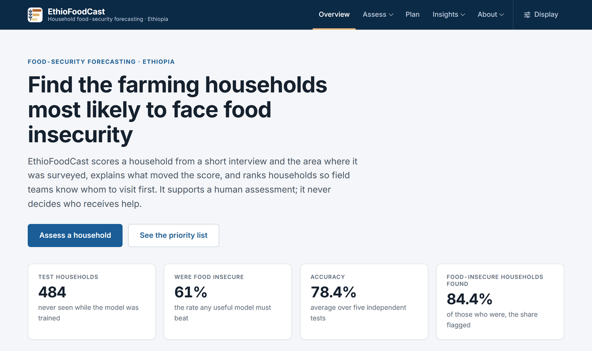
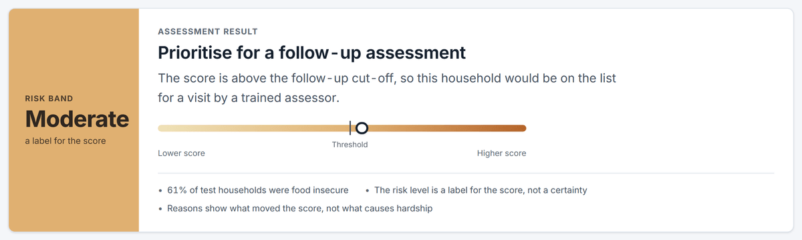
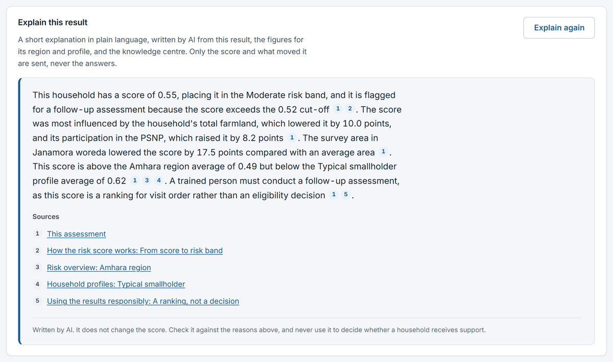
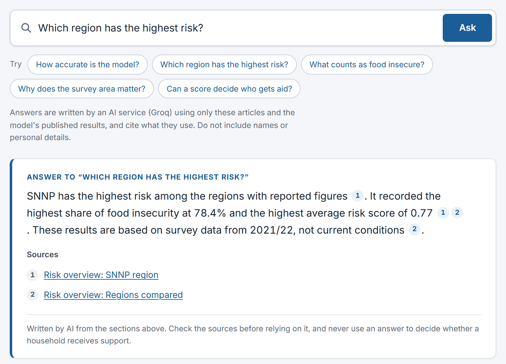
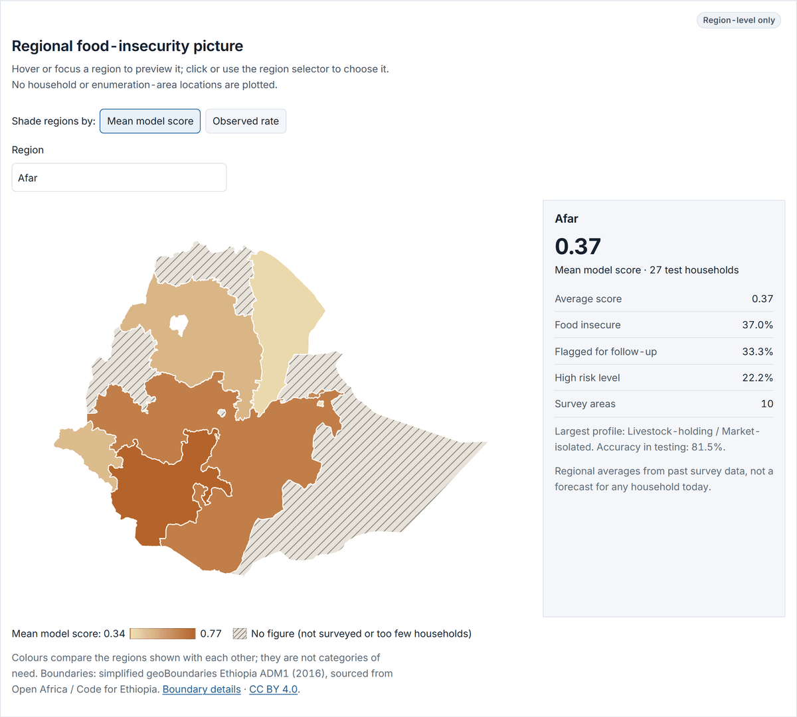

<p align="center">
  
</p>

<h1 align="center">EthioFoodCast</h1>

<p align="center">
  <strong>Find the Ethiopian farming households most likely to face food insecurity, so field teams know whom to visit first.</strong>
</p>

<p align="center">
  <a href="https://ethio-food-cast.vercel.app"></a>
  <a href="LICENSE"></a>
  
  
</p>

EthioFoodCast scores a farming household from a 14-question interview and the area where it
was surveyed, explains what moved the score, and ranks households so programme staff can plan
follow-up visits. A graph neural network trained on the World Bank's Ethiopia household panel
learned how a household's situation in 2018/19 relates to whether it reported food insecurity
three years later. The score supports a human assessment; it never decides who receives help.

**Try it:** https://ethio-food-cast.vercel.app (the API sleeps when idle, so the first score
can take about a minute).

<p align="center">
  
</p>

## Results

Tested on farming households the model never saw while it was trained: in every survey area,
every fourth household was set aside before training, and this was repeated five times.

| Measure | Result |
|---|---|
| Accuracy (average of five test splits) | **78.4%** (± 1.9) |
| Food-insecure households found (recall) | **84.4%** |
| Flagged households that were food insecure (precision) | **80.2%** |
| ROC-AUC | **0.86** |
| Baseline: share of test households food insecure | 61% |
| Training data | 4,837 households in 427 survey areas |

In a like-for-like comparison the graph neural network came out ahead of extra trees, LightGBM
and logistic regression (77.0% accuracy against 76.6%, 74.8% and 67.9%).
Limits, the regions without enough data, and how to read a score are set out in the
[Knowledge centre](https://ethio-food-cast.vercel.app/knowledge/accuracy-and-limits).

## What it does

<table>
  <tr>
    <td width="50%"></td>
    <td width="50%"></td>
  </tr>
  <tr>
    <td><strong>Assess a household.</strong> A short stepped interview, scored on the spot, with the answers that moved the score, the survey area's effect, follow-up topics and a what-if comparison.</td>
    <td><strong>Explain this result.</strong> A plain-language explanation written by AI from the result, its region and profile figures and the documentation, citing a source for every sentence.</td>
  </tr>
  <tr>
    <td></td>
    <td></td>
  </tr>
  <tr>
    <td><strong>Ask the knowledge centre.</strong> Questions about the data, the model and its results are answered from the project's own articles and figures, with citations; questions they cannot answer are refused.</td>
    <td><strong>Explore the results.</strong> Risk by region and household profile, a ranked planning list with a capacity slider, batch scoring from a CSV, and an offline-capable interface for field use.</td>
  </tr>
</table>

## How it works

```
ESS 2018/19 + ESPS 2021/22 survey panel (World Bank LSMS-ISA)
        │  cleaning, features, food-insecurity label (FIES)
        ▼
Graph neural network ensemble ── households linked to their survey area and nearby areas
        │  exported model + result files
        ▼
FastAPI scoring service (Render)  ◄────  Next.js website (Vercel)  ────►  Groq
  /api/predict, /api/predict_batch        dashboards built from the          cited answers via
                                          result files; knowledge centre     retrieval-augmented
                                                                             generation
```

- **Model.** A graph convolutional network ensemble over households and survey areas, with
  satellite rainfall and vegetation for each area. Reasons come from occlusion: leave one
  answer unknown and score again.
- **API.** FastAPI in Docker, with input validation, rate limits and CORS.
- **Website.** Next.js 15 and TypeScript. Dashboards are static pages built from the model's
  result files, validated at build time.
- **AI.** Retrieval-augmented generation over the documentation and the model's results. Every
  sentence must cite a source, and the server rejects answers whose citations do not check out.
- **Privacy.** No household identifiers or coordinates are shipped; small regions are
  suppressed; the AI never receives interview answers.

| Layer | Tools |
|---|---|
| Model | Python, NumPy/SciPy graph convolutional network ensemble, scikit-learn, LightGBM baselines, SHAP |
| API | FastAPI, Uvicorn, Docker, Render |
| Website | Next.js 15, React 19, TypeScript, zod, Vercel |
| AI | Groq, keyword retrieval with citation checking |

## Team

| Name | Role | Profiles |
|---|---|---|
| Henok Solomon | Data and frontend | [LinkedIn](https://www.linkedin.com/in/henok-solomon-ai/) · [GitHub](https://github.com/HenokInTheStars) |
| Niyat Debesay | Machine learning and backend | [LinkedIn](https://www.linkedin.com/in/niyat-debesay-6890b5285/) · [GitHub](https://github.com/niyatdebesay) |
| Amina Aman | Product and analytics | [LinkedIn](https://www.linkedin.com/in/amina-aman-6a475333a/) · [GitHub](https://github.com/aminaaman44) |

## Licence, data and citation

The code is released under the [MIT licence](LICENSE). The survey data is not included: it is
published by the Ethiopian Statistical Service and the World Bank under their own terms (see
[Data sources and how to cite](frontend/content/knowledge/08-sources-and-citation.md)). To
cite EthioFoodCast, use GitHub's "Cite this repository" button ([`CITATION.cff`](CITATION.cff)).

EthioFoodCast is an independent project, not an official product of any government or agency.

---

# For developers

The model takes a household's 2018/19 situation (the household, its land and crops, its
livestock and its livelihood, plus its survey area's rainfall and vegetation) and returns the
probability that it reported food insecurity in 2021/22, with explanations, a household
profile and rule-based follow-up topics. The intake form has 14 questions (at least 9 must be
answered); household size, dependency ratio, livestock units and per-person values are
calculated.

## Run

Needs Python 3.11 or 3.12 (the Docker image uses 3.11). The first run creates the repository-root `.venv` and installs
`backend\requirements.txt` (a few minutes, internet needed); later runs start at once:

```bat
backend\start_api.bat                                :: API on http://localhost:5000
.venv\Scripts\python.exe -m pytest backend\tests -q  :: expect 90 passed, 1 skipped
```

By hand:

```bat
python -m venv .venv
.venv\Scripts\python.exe -m pip install -r backend\requirements.txt
.venv\Scripts\python.exe -m uvicorn backend.api_server:app --port 5000
```

API docs: http://localhost:5000/docs

## Run in Docker

Needs Docker with the Compose plugin. The API image is self-contained (the model
artifacts are copied in, ~53 MB of pickles):

```bat
docker compose up --build                       :: API on http://localhost:5000
docker compose run --rm api python -m pytest tests -q
docker compose --profile demo up --build        :: adds the Next.js demo on :3001
docker compose logs -f api
docker compose down -v
```

Both services publish to `127.0.0.1` only: there is no authentication in this
project, so the stack must not answer on the LAN.

If port 5000 or 3001 is already taken by something else on the machine, override
the host ports. `NEXT_PUBLIC_API_URL` is baked into the browser bundle at build
time, so it has to move with `API_PORT` — change it in the same command:

```bat
set API_PORT=5010
set WEB_PORT=3010
set NEXT_PUBLIC_API_URL=http://localhost:5010
docker compose --profile demo up --build
```

`frontend/` also builds on its own:

```bat
npm --prefix frontend install
npm --prefix frontend run build   :: regenerates frontend/data from backend/artifacts, then builds
npm --prefix frontend run dev     :: http://localhost:3001, needs the API running
```

## Deploy

The API runs on Render (from [`render.yaml`](render.yaml)) and the website on Vercel, both
on free plans. `docs/DEPLOYMENT.md` has the step-by-step guide. Set `ALLOWED_ORIGINS` on the
API to the website's address. A scheduled GitHub Action keeps the free API from sleeping during the day. Scoring is rate-limited per visitor (settings in the guide).

## Use from Python (Streamlit)

Streamlit is not part of the server requirements; install it with
`pip install "streamlit>=1.40,<2"` if you build a Streamlit app.

```python
from backend import Service
svc = Service()
area = svc.areas()[0]
result = svc.predict({"area_id": area["id"],
    "n_children": 3, "n_working_age": 2, "n_elderly": 1,                       # household
    "land_total_area": 4000, "land_any_irrigated": 0, "crop_diversity": 3,     # land and crops (m², count)
    "crop_any_damage": 1, "harvest_any_shortfall": 0,
    "livestock_cattle": 2, "livestock_small_ruminants": 5, "livestock_poultry": 6,
    "econ_has_nonfarm_business": 0, "econ_psnp": 1, "econ_total_assets": 5})   # livelihood
form = svc.graph_form(short=True)    # the 14 questions, grouped, with labels via svc.field_labels()
```

Read `docs/STREAMLIT_HANDOFF.md` (how to build the frontend: form, response,
errors, pages) and then `docs/GRAPH_BACKEND_HANDOFF.md` (the GCN model,
explanations, graph dashboard methods and HTTP API).

## What is here

| Path | Contents |
|---|---|
| `backend/__init__.py`, `backend/backend.py` | Python service import facade (`from backend import Service`) |
| `backend/api_server.py` | FastAPI wrapper over the same Service |
| `backend/start_api.bat` | Starts the API; creates the root `.venv` if missing |
| `backend/src/ethiofoodcast/serving/` | Graph model inference, calculated inputs, the Service |
| `backend/src/ethiofoodcast/contracts/`, `rules/`, `export/` | Validation, support rules, privacy |
| `backend/src/ethiofoodcast/features/`, `data/`, `cleaning/`, `target/` | How the survey data and label were built |
| `backend/src/ethiofoodcast/eda/`, `explain/`, `evaluation/`, `models/` | EDA figures, explanations, metrics, preprocessing and segments |
| `backend/artifacts/graph_serving.joblib` | GCN ensemble, 14-question agricultural form (NumPy inference, no raw data) |
| `backend/artifacts/model_bundle.joblib` | Segment model and the fallback used when no survey area is given |
| `backend/artifacts/ui_graph/` | Dashboard data (held-out, aggregated, anonymised), labels, help texts, area names |
| `backend/artifacts/ui/clusters.json` | Segment summary |
| `frontend/` | Next.js workspace: interview form, dashboards, and offline keyword search over bundled project evidence |
| `backend/reports/figures/` | EDA, segmentation and model figures |
| `backend/reports/graph_serving/verification.json` | Export verification record |
| `backend/tests/` | Contract, serving, validation and API tests |
| `docs/` | Frontend design and developer handoff guides |

No raw survey data, household IDs or coordinates are included.

## Knowledge centre

`/knowledge` holds plain-language articles for visitors: the data, how the score works,
accuracy and limits, responsible use, a glossary, an FAQ, and data sources with how to cite. The articles are Markdown files in
`frontend/content/knowledge/` (`NN-slug.md`, with `title` and `summary` front matter). Figures
are written as `{{placeholders}}` that `npm run data` fills from the model's result files, so the
text always matches the dashboards; an unknown placeholder or a broken `/knowledge` link fails
the build.

`npm run data` also writes short summaries of the model's results (each region, each household
profile, the overall risk levels and what moves the scores) as extra passages that link to the
dashboard showing those figures, so questions such as "Which region has the highest risk?" are
answered from the same numbers the pages show.

Both AI features are retrieval-augmented generation (RAG) with Groq, sharing
`frontend/lib/rag.ts`:

- **Ask** (Knowledge centre). Typing searches the passages in the browser, offline. Ask sends
  only the question to `/api/knowledge/ask`, which picks the six best passages on the server and
  has Groq answer from them alone.
- **Explain this result** (Assess page). `/api/knowledge/explain` receives the score, band, what
  moved it, the survey area id and the profile id (never the interview answers). It writes the
  result out on the server, adds the region and profile summaries and the sections on how scores
  work, and has Groq explain the result in plain language.

Every sentence must cite a source, and an answer without valid citations is rejected. Only
same-origin browser requests are accepted. Visitors' offline library files are never sent. The routes need
`GROQ_API_KEY` and `GROQ_MODEL` in the server environment (for local development, in
`frontend/.env.local`, never with a `NEXT_PUBLIC_` prefix); without them, search still works and
the Ask button is hidden. Questions are limited to 6 a minute per visitor and 60 a minute in
total (`ASK_RATE_LIMIT`, `ASK_GLOBAL_RATE_LIMIT`).

The page also has a hand-picked reading list (`frontend/lib/further-reading.ts`), recent
publications from official sources (titles, dates and links only), a copyable citation with
BibTeX (kept in step with [`CITATION.cff`](CITATION.cff)), and a browser-local library for the visitor's own PDF, TXT and Markdown files, stored in
IndexedDB and never uploaded.

To refresh official-source metadata while online, run:

```bat
.venv\Scripts\python.exe scripts\sync_official_sources.py
npm --prefix frontend run data
```

The metadata sync is currently manual; schedule it only in an environment with outbound access
and after reviewing the configured source registry. In a production PWA, open `/knowledge` online
once to cache its route and assets for offline use; the development server does not enable offline
caching.
